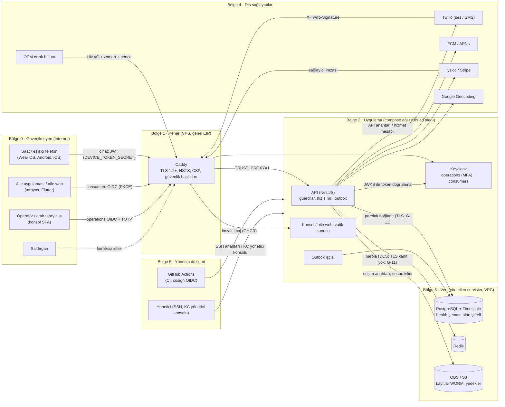

# Tehdit modeli (STRIDE)

T-081, ASVS 1.1.2 (G-13), 1.1.4 (güven sınırı diyagramı), 1.1.5 (bileşen analizi). Kapsam: v1.0 mimarisi
(`docs/03-teknik-mimari.md`). Tarih: 2026-11-11, güncelleme 2026-11-13 (diyagram, bileşen analizi, I6, T3). Her tasarım
değişikliğinde (yeni uç, yeni dış servis, yeni veri türü) ilgili bölüm güncellenir; PR açıklamasında "tehdit modeli
etkisi: yok / bölüm X güncellendi" yazılır.

## Varlıklar

| Varlık | Neden değerli | Nerede |
| --- | --- | --- |
| Acil olayın zamanında işlenmesi | Hayati: gecikme veya kayıp doğrudan zarar | `signal` → outbox → `event`, operatör kuyruğu |
| Sağlık verisi (tıbbi özet) | Özel nitelikli kişisel veri (KVKK m.6) | `health.medical_summary` (AES-256-GCM alan şifreleme) |
| Kişi, adres, kapı erişim notu, iletişim zinciri | Kişisel veri; adres + kapı notu fiziksel risk | `profile` şeması (kapı notu şifreli) |
| Görüşme kayıtları | Ses (sağlık bilgisi içerebilir) | S3 nesne kilidi, yalnız gerekçeli erişim + audit |
| Operatör / yönetici oturumu | Tüm kişilere ve sağlık verisine erişim | Keycloak `operations` (MFA), konsol `sessionStorage` |
| Cihaz token'ı | Kişi adına sinyal üretme | Saat / telefon güvenli depolama |
| Arama / SMS bütçesi | Maliyet ve hat kapasitesi | CPaaS hesabı |

## Güven sınırları

1. Saat / telefon → API (`/v1/signals`, `/v1/devices/*`): cihaz token'ı (JWT, `kid`'siz tek anahtar — G-7).
2. Aile uygulaması / aile web → API: Keycloak `consumers` realm (FAMILY).
3. Konsol → API + WebSocket: Keycloak `operations` realm (OPERATOR / SUPERVISOR / ADMIN, MFA zorunlu).
4. CPaaS / SMS / ödeme / ön eleme sağlayıcısı → webhook uçları: sağlayıcı imzası.
5. API → veri depoları (Postgres, Redis, S3): iç ağ (TLS kanıtı G-11).
6. Operatör → 112: insan, telefon (sistem dışı; süreç takibi `dispatch` modülünde).
7. Üretici bulutu (OEM ortağı) → `POST /v1/webhooks/partners/{partner}`: HMAC imza + zaman penceresi + nonce.
8. API → dış sağlayıcılar (Twilio, FCM / APNs, iyzico / Stripe, Google Geocoding): giden TLS, sağlayıcı anahtarı.
9. Yönetim düzlemi: Keycloak yönetici konsolu, sunucuya SSH, bulut konsolu, GitHub (CI sırları, imza kimliği).

### Güven sınırı diyagramı (ASVS 1.1.4)

Kesik çizgili kutular güven bölgeleridir; her ok bir sınır geçişidir ve üzerindeki etiket o geçişin kimlik
doğrulamasıdır. Kaynak: `infra/docker-compose.prod.yml` (servisler, tek `yanimda` ağı), `infra/caddy/Caddyfile`
(genel adlar), `infra/terraform/modules/yanimda-env/main.tf` (yönetilen veri depoları, DNS), `apps/api/src/app.module.ts`.

## STRIDE

| # | Sınır | Tehdit | Örnek senaryo | Önlem (repoda) | Kalan risk / iş |
| --- | --- | --- | --- | --- | --- |
| S1 | 1 | **Kimlik sahteciliği** | Ele geçirilmiş / tahmin edilen eşleştirme kodu ile sahte cihaz kaydı → sahte SOS | 6 haneli kod 15 dk, tek kullanım; IP başına hata sayacı; `POST /devices/enroll` hız sınırı (IP, 20/10 dk); `TRUST_PROXY` ile gerçek IP | Dağıtık saldırgan (G-1): sızma testinde doğrulanacak |
| S2 | 1 | Kimlik sahteciliği | Bir cihazın token'ıyla başka kişinin sinyalini göndermek | `CompanionService.authorizeBatch` (kişi/cihaz + köprü denetimi, sinyal başına): yetkisiz sinyal yazılmaz, `rejected` içinde döner; partide yetkili sinyal yoksa 403 | — |
| S3 | 3 | Kimlik sahteciliği | Operatör parolası oltalaması | MFA (TOTP) zorunlu, `bruteForceProtected`, parola ≥ 12 | WebAuthn (v2) |
| S4 | 4 | Kimlik sahteciliği | Sahte CPaaS webhook'u ile arama sonucunu "cevaplandı" göstermek | Twilio imza doğrulaması; webhook hız sınırı | Zaman damgasız imza → tekrar oynatma (G-17) |
| T1 | 1 | **Kurcalama** | Sinyal içeriğinin (konum, tür) yolda değişmesi | TLS (Caddy ACME, HSTS); şema doğrulaması | Mobil sertifika sabitleme (G-14) |
| T2 | 5 | Kurcalama | Audit kaydının silinmesi | `audit.log` yalnız ekleme (append-only) | DB rol ayrımı (G-8) |
| R1 | 3 | **İnkâr** | Operatörün "112'yi aradım" demesi, aramamış olması | Her geçişte `actorKind`/`actorId`/`at`; 112 bildirimi kaydı, kapanışta `event.closed_without_112` + amir uyarısı; kayıt erişimi gerekçeli + audit | 112 tarafı teyidi sistem dışı (manuel prosedür) |
| R2 | 2 | İnkâr | Aile "test SOS'u ben başlatmadım" | Test SOS idempotency + audit (aktör kimliği) | — |
| I1 | 1–3 | **Bilgi ifşası** | Log'a ad / telefon / adres yazılması | Log'da PII yok kuralı; `safeError`; CI PII log denetimi (e2e); güvenlik olayı log'u yalnız rota şablonu + istek kimliği | — |
| I2 | 2 | Bilgi ifşası | Başka ailenin kişisini görmek (IDOR) | Sahiplik denetimi → 404; MEMBER yazamaz (403) | — |
| I3 | 3 | Bilgi ifşası | XSS ile konsol token'ının çalınması → sağlık verisi | CSP `script-src 'self'` (Caddy), React kaçışlama, `frame-ancestors 'none'` | Helm ingress'te CSP yok (Caddy dağıtımı esas) |
| I4 | 1–3 | Bilgi ifşası | Paylaşılan / vekil önbelleğinde profil yanıtı | API varsayılanı `Cache-Control: no-store` | — |
| I5 | 5 | Bilgi ifşası | Yedekten / diskten sağlık verisi | Alan şifreleme (sağlık, kapı notu); S3 nesne kilidi | Disk şifreleme kanıtı (G-10), KMS (G-7) |
| D1 | 1 | **Hizmet engelleme** | Kötü niyetli / bozuk cihaz saniyede yüzlerce sinyal → kuyruk taşması | `/signals` cihaz başına 600/dk; **alarm sinyalleri (SOS, FALL, INACTIVITY, CANCEL, OK, CALLBACK_REQUEST) hiç sınırlanmaz**; Redis yoksa sınır açık | — |
| D2 | 2 | Hizmet engelleme / maliyet | Kayıt akışında SMS bombalama, test SOS ile arama maliyeti | Kayıt IP başına 10/sa, SMS kodu 5/sa, test SOS kişi başına 6/sa (ve 10 dk kuralı), davet 10/sa | — |
| D3 | 5 | Hizmet engelleme | Redis / Postgres kesintisi | Outbox (olay kaybı 0), Postgres kapalıyken 503 + cihaz tamponu; kaos testleri CI'da | — |
| E1 | 3 | **Yetki yükseltme** | OPERATOR'ün yönetim uçlarına erişmesi | Rol denetimi (`Roles`, `MANAGEMENT_ROLES`); 403 güvenlik olayı olarak loglanır | — |
| E2 | — | Yetki yükseltme | `ADMIN_TOKEN` sızıntısı → tüm profiller | Üretimde kısıtlama planı | G-4: hizmet hesabına geçiş |
| I6 | 2 | Bilgi ifşası | Çalınan aile oturumuyla `GET /family/data-export` → tüm kişilerin verisi tek dosyada | Yeni yetki yok (yalnız aile uçlarının gösterdiği); tıbbi özet içeriği, tam numara, konum geçmişi yok; kullanıcı başına 5/sa; her indirme audit'te | Oturum süreleri (R-2, `risk-kabulleri.md`) |
| T3 | 5 | Kurcalama / kayıp | Yanlış saklama ayarıyla (`*_RETENTION_DAYS=1`) erken veri silinmesi | Okuyan kodun penceresi taban: altı açılışı durdurur; DLQ / işlenmemiş outbox / audit hiç silinmez; tur özeti audit'te (`saklama.md`) | — |

## Bileşen güvenlik analizi (ASVS 1.1.5)

Her bileşen için: güven bölgesi (diyagram), işlediği en hassas veri, kimlik doğrulama, temel kontroller (kanıt),
kalan risk. "G-n" `asvs-l2.md` açıklarına, "R-n" `risk-kabulleri.md`'ye bağlanır.

| Bileşen | Bölge | En hassas veri | Kimlik doğrulama | Temel kontroller (kanıt) | Kalan risk |
| --- | --- | --- | --- | --- | --- |
| Saat / eşlikçi telefon | 0 | Konum, düşme / SOS, cihaz token'ı | Eşleştirme kodu → cihaz JWT | Kod 15 dk tek kullanım, IP sayacı (`enrollment.service.ts`); sinyal başına kişi / köprü yetkisi (`companion.service.ts`); iptal anında (`revoked_at`) | G-1 dağıtık kod tahmini; G-14 sabitleme; G-7 tek anahtar |
| Aile web (Next.js) | 0 / 2 | Aile oturumu, kişi profili, dışa aktarma dosyası | consumers PKCE; token `sessionStorage`, 5 dk, yenileme yok (`apps/family-web/src/lib/oidc.ts`) | Metin katalogdan; `frame-ancestors`; dosya içeriği saklanmaz (`data-export.ts`) | R-3 `sessionStorage`; CSP kısmi (14.4.3) |
| Operatör konsolu (React SPA) | 0 / 2 | Olay anında tıbbi özet, kapı notu, adres | operations OIDC + TOTP; `sessionStorage` (`apps/console/src/lib/auth.ts`) | Caddy CSP `script-src 'self'`, HSTS; tıbbi özet yalnız olay kartında + audit (`profile.service.ts` `eventCard`) | R-3 XSS → token; G-5 izleme |
| Caddy (kenar) | 1 | TLS anahtarları, tüm trafik | — | ACME TLS, HSTS, `nosniff`, `Referrer-Policy`, CSP, `-Server` (`infra/caddy/Caddyfile`); metrik ucu yayınlanmıyor | Tek VPS (kullanılabilirlik); 10.3.3 DNS (`dns-envanteri.md`) |
| API (NestJS) | 2 | Tüm kişisel / sağlık verisi (bellekte çözülmüş) | Guard'lar: cihaz JWT, OIDC (iki realm, `aud`, `amr` otp), sağlayıcı imzası, `x-admin-token` | Yetki → 404 / 403; hız sınırı (`rate-limit.ts`); `no-store`, güvenlik başlıkları (`http-security.ts`); `safeError`; outbox (olay kaybı 0); alan şifreleme (`field-cipher.ts`); saklama işi (`privacy/retention.service.ts`) | G-4 `ADMIN_TOKEN`; R-1 bellekte silme; 13.1.5 içerik türü |
| Outbox işçisi | 2 | Olay zarfları | DB bağlantısı | Kira (lease) ile tek işçi; DLQ, side şeridi (`outbox.worker.ts`); işlenmiş satır 7 gün | — |
| Keycloak | 2 | Parola özetleri, OTP sırları, oturumlar | Realm başına; yönetici konsolu | operations: MFA zorunlu, `resetPasswordAllowed: false`, parola 12, brute force; consumers: parola 12, `notEmail`; olay kaydı 90 gün + e-posta bildirimi (`infra/keycloak/realm-*.json`) | G-9 / R-2 consumers oturum süresi; 2.1.7 ihlal listesi; G-20 üretim URI'leri |
| PostgreSQL + Timescale | 3 | `health` (şifreli), `profile` (ad, telefon, adres düz) | Parolalı rol | Yönetilen RDS, PITR, OBS yedek 35 gün; `audit.log` append-only tetikleyici; alan şifreleme | G-8 rol ayrımı; G-10 düz metin PII; G-11 TLS kanıtı |
| Redis | 3 | Hız sınırı sayaçları, idempotency anahtarları, zamanlayıcı işleri | Parola (DCS) | PII yok; TTL'li anahtarlar; Redis yoksa yerel yedek zamanlayıcı (`bull-timers.ts`) | G-11 TLS |
| OBS / S3 | 3 | Görüşme kayıtları (ses), DB dökümleri | Erişim anahtarı | Nesne kilidi COMPLIANCE, SSE AES256, sürümleme; kayıt erişimi gerekçeli + audit | Kayıt yaşam döngüsü kuralı yok (`saklama.md` S-2); statik anahtar (2.10.1) |
| Twilio (CPaaS) | 4 | Aranan numara, ses | Hesap SID + token (giden), `X-Twilio-Signature` (gelen) | İmza doğrulaması; numara satırda tutulmaz (`telephony.call` → `contact_id`) | G-17 tekrar oynatma; yurt dışı aktarım (KVKK) |
| FCM / APNs | 4 | Bildirim kodu, alıcı token'ı | Hizmet hesabı / APNs anahtarı | Bildirim kaydında metin ve numara yok (`notify.notification`: kod + alıcı kimliği); geçersiz token silinir | — |
| iyzico / Stripe | 4 | Ödeme (kart sağlayıcıda) | API anahtarı; webhook imzası | Kart verisi hiç bizde değil; webhook tekrar ayıklama (`payment_webhook`) | — |
| OEM ortak bulutu | 4 | Ortak cihaz olayları | HMAC + ±5 dk + nonce | Bağlantı başına KVKK aktarım dayanağı (`vendor_link`); sınıf kapısı (`partner-webhook.service.ts`) | Gerçek ortak entegrasyonu yok |
| GitHub Actions | 5 | CI sırları, imza kimliği | GitHub OIDC (cosign) | Sabit sürümlü eylemler / imajlar, `permissions: contents: read`, Dependabot (`sdlc.md`) | `sdlc.md` D-1 dal koruması kanıtı, D-2 dağıtımda doğrulama |

## İzleme

- API: `yanimda_security_events_total{status,route}` (400/401/403/422/429). `SecurityEventsSpike` uyarısı
  (`infra/monitoring/alerts.yml`): 10 dk'da 200'den fazla 401/403/429. İlk adım: Grafana'da rota kırılımı; tek
  rotada 401 artışı → kimlik bilgisi denemesi / süresi dolmuş istemci; 429 artışı → hız sınırına takılan cihaz
  sürümü veya saldırı; istek kimliği (`X-Request-Id`) ile API log'una git.
- Keycloak: realm olay kaydı açık (`eventsEnabled`, 90 gün, DB'de; log'a yazılmaz çünkü kullanıcı adı / IP içerir),
  yönetici olayları açık (ayrıntısız). Parola / OTP değişikliği ve hatalı giriş kullanıcıya e-posta ile bildirilir
  (`email` dinleyicisi).

## Gözden geçirme

Sızma testi planı (`sizma-testi-plani.md`) bu tablodaki "kalan risk" sütununu öncelik sırası olarak kullanır.
